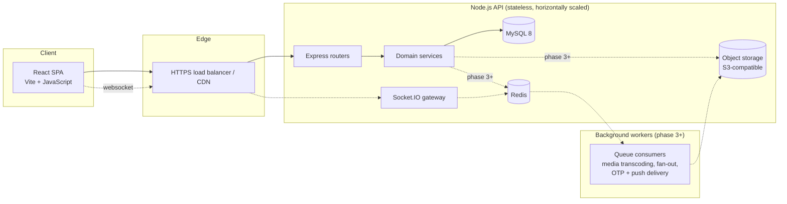
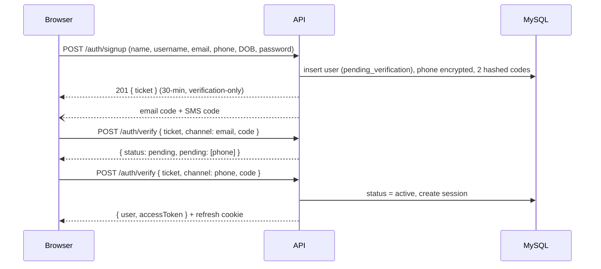

# SocialAmbak architecture

## System overview

The API is a modular monolith: one deployable, split into modules (`auth`, `users`, then `social`, `posts`,
`stories`, `messages`, `notifications`, `search`, `moderation`). Each module owns its routes, validation schemas
and service functions. Modules talk through service functions, never each other's tables, so any of them can be
split into its own service later without a rewrite.

API instances hold no session state, so they scale horizontally behind a load balancer. Anything shared between
instances (rate-limit counters, Socket.IO rooms, hot caches) moves to Redis when that phase lands.

## Request lifecycle

`helmet` security headers → strict CORS (one allowed origin, credentials on) → JSON body (100 kB cap) →
per-IP rate limit → route-specific limiter → zod validation → `requireAuth` where needed → service →
uniform response `{ data }` or `{ error: { code, message, details } }`. Unknown errors are logged server-side and
returned as a generic 500.

## Authentication and session design

| Concern | Approach |
| --- | --- |
| Passwords | argon2id (19 MiB memory, 2 iterations), PHC string in `users.password_hash`. Never logged or returned. |
| Account enumeration on sign-in | Same error and same timing whether the account exists or not (a dummy argon2 verify runs on misses). |
| Brute force | Per-IP limiter on the route plus a per-account cap of 10 failures per 15 minutes. |
| Access token | JWT (HS256), 15-minute lifetime, held only in browser memory, sent as `Authorization: Bearer`. |
| Refresh token | 256-bit random value in an `httpOnly`, `SameSite=Strict`, `Secure` (prod) cookie scoped to `/api/v1/auth`. Only its SHA-256 hash is stored. |
| Rotation | Every refresh issues a new token and retires the old one. Reusing a retired token revokes the whole token family (theft detection). A 15-second window handles two tabs refreshing at once. |
| Revocation | Each request checks the session row, so "log out of all devices" and suspensions apply immediately. |
| CSRF | Cookie endpoints require the `X-SocialAmbak-Client` header, which forces a CORS preflight only the app origin passes; combined with `SameSite=Strict`. |

### Sign-up and verification flow

Codes are 6 digits from a CSPRNG, stored only as an HMAC, valid 10 minutes, 5 attempts each, 60-second resend
cooldown and at most 5 sends per hour per channel. Sign-ups that are never verified are purged after 24 hours,
which also releases their username, email and phone.

## Data protection

- **Mobile numbers**: normalised to E.164, then encrypted with AES-256-GCM (random IV, auth tag, and the user id as
  associated data so ciphertexts can't be moved between rows). A separate HMAC-SHA256 "blind index" makes the
  number unique and lets people sign in with it without ever decrypting. Keys carry a version number for rotation.
  The UI only ever receives a masked number.
- **Emails** are stored in plain text because they are needed for case-insensitive uniqueness, sign-in and
  delivery; protect them with encrypted database volumes and backups (standard on RDS, Cloud SQL and Azure Database for MySQL).
  The same encrypt-plus-blind-index pattern can be applied if you want field-level encryption for email too.
- **Keys** are four independent 256-bit secrets from the environment; the server refuses to start if any are missing,
  malformed or reused. In production keep them in a secrets manager (AWS Secrets Manager, GCP Secret Manager, Vault).
- **SQL injection**: every query is parameterised.
- **Least data in responses**: the profile DTO is an explicit allow-list of fields.

## Database

MySQL 8 (InnoDB, `utf8mb4`). The full schema lives in `server/migrations/001_init.sql` and already covers
every feature area. MySQL-specific choices:

- **IDs** are plain numbers (1, 2, 3, ...): `BIGINT UNSIGNED AUTO_INCREMENT`, handed out by MySQL on insert and never encrypted. They are strings of digits in the app and in JSON.
  `lib/ids.js` validates an id on the way in (`toBin`, `isId`); the pool returns every `*_id` column as a string.
- **Case-insensitive** usernames and emails come from the `utf8mb4_0900_ai_ci` collation.
- **Time**: every `DATETIME(3)` is UTC; the pool sets `time_zone = '+00:00'` on each connection.
- **Search** uses `FULLTEXT ... WITH PARSER ngram` indexes on usernames, names and hashtags, so partial words match.
- **Constraints** MySQL can't express (it forbids `CHECK` on columns with cascading foreign keys, such as "a user
  can't follow themselves") are enforced in the service layer.
- **Migrations**: MySQL commits DDL immediately, so a failed migration isn't rolled back. Keep one logical change
  per file and rehearse on a copy of production data.

| Area | Tables |
| --- | --- |
| Identity | `users`, `user_settings`, `sessions`, `verification_codes` |
| Social graph | `follows` (with `pending` status for private accounts), `blocks`, `mutes` |
| Content | `posts` (`kind` = post or reel), `post_media` (carousel up to 10), `hashtags`, `post_hashtags`, `post_mentions` |
| Engagement | `post_likes`, `comments` (with `parent_id` for replies), `comment_likes`, `saved_posts`, `saved_collections` |
| Stories | `stories` (`expires_at` = +24 h), `story_views` |
| Messaging | `conversations` (`dm_key` keeps 1:1 chats unique), `conversation_members` (message requests, read state), `messages` (text, media, shared posts, replies) |
| Notifications | `notifications` indexed by recipient and read state |
| Safety | `reports` (moderation queue) |
| History | `activity_log` (security events and activity history), `search_history` |

Design notes: numeric auto-increment keys (readable, small, ordered by time; every endpoint checks who may see a row, so a guessable id is no way in); counters such as `like_count` are
denormalised and updated inside the same transaction as the like, so feeds never `COUNT(*)`; feed and inbox
queries are backed by `(owner, created_at DESC)` indexes for cursor pagination; media rows store object-storage
keys, never local paths.

## Roadmap

| Phase | Scope |
| --- | --- |
| 1 — done | Brand, design system, schema, secure sign-up/sign-in with email + SMS verification, sessions, dark mode |
| 2 | Profiles: edit profile, avatar upload (presigned S3 URLs), public/private, follow / unfollow / requests, block, mute, password reset |
| 3 | Posts and reels: media upload pipeline, home feed with cursor pagination, likes, comments and replies, hashtags, mentions, saves and collections, sharing |
| 4 | Stories: 24-hour stories, viewers list, story replies; video transcoding worker |
| 5 | Real time: Socket.IO with Redis adapter, direct messages with media, typing and read receipts, live notifications |
| 6 | Search and explore (ngram full-text search, trending hashtags), reporting and moderation tools, activity history, full settings |
